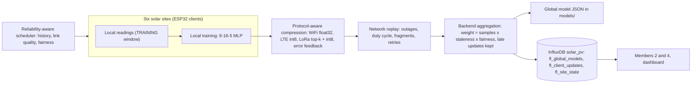

# Component 3 - Federated Learning and backend

## Member 3: protocol-aware federated learning (PP1)

Python research code. It trains a shared 8-16-5 MLP fault classifier across six simulated solar sites
without sharing raw readings, over WiFi, LTE and LoRa links replayed from the shared network traces.

### Architecture

### Implemented (guide steps 1 to 10)

| Step | Files |
|---|---|
| 1 Data loader | `src/data_loader.py` |
| 2 InfluxDB schema and loader | `docker-compose.yml`, `src/load_to_influx.py`, `src/verify_influx.py` |
| 3 FedAvg rebuilt from shared files | `src/fedavg_baseline.py` |
| 4 Network replay, validated against the shared trace | `src/network_replay.py`, `src/validate_replay.py` |
| 5 FedAvg baseline (Flower `NumPyClient` sites) | `src/fl_baseline.py`, `src/mlp.py`, `src/pv_data.py` |
| 6 Protocol-aware compression | `src/compression.py` |
| 7 Reliability-aware scheduler | `src/scheduler.py` |
| 8 Asynchronous aggregation, staleness and fairness weights | `src/engine.py` |
| 9 Scenarios, evaluation, ablation | `src/scenarios.py`, `src/evaluate.py`, `src/paired.py` |
| 10 Results in the shared format and InfluxDB | `src/export_results.py` |

### Results (5 seeds, mean ± standard deviation)

| | Normal trace: baseline | Normal